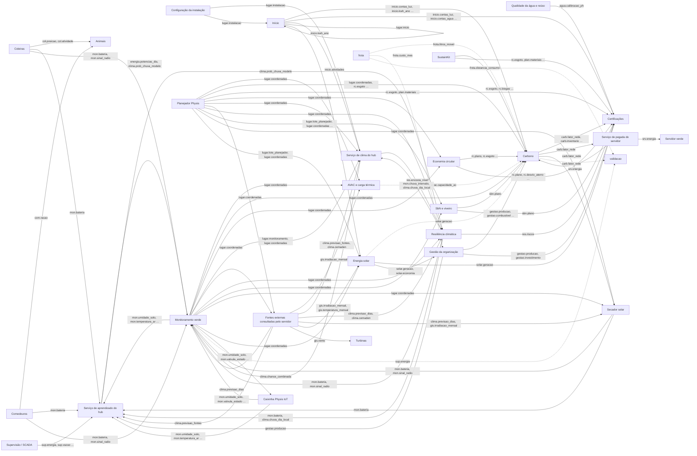

# Mapa de variáveis e fluxo de dados

Versão de 15/11/2026. O arquivo que manda é `sistema/physis-variaveis.json`; este texto é a leitura simples dele. O teste `physis-hub/tests/test_variaveis.py` confere os dois contra o código.

## Por que existe

A loja vende módulos separados. Cada módulo lê números que outros módulos produzem (a geração solar vai para o Carbono, o local do Monitoramento vai para a previsão do tempo). Se a pessoa compra um módulo sem o que produz a entrada dele, o fluxo quebra. Este mapa diz, para cada número: de onde vem, quem usa, onde fica guardado e o que o sistema faz quando falta.

**Números:** 126 variáveis (27 medido, 25 digitado, 31 calculado, 37 premissa, 6 externo), 17 estatísticas e modelos, 140 ligações entre módulos, 31 lacunas por compra e 6 rupturas que existem mesmo com tudo comprado.

Tipos: **medido** (aparelho), **digitado** (pessoa), **calculado** (sistema), **premissa** (base de premissas), **externo** (NASA, Open-Meteo, INMET, CEMADEN).

## Fluxo entre módulos

Linha cheia = leitura automática. Linha tracejada = só sugestão ou exemplo no campo (a pessoa confirma).

Exemplos de cadeia: Energia solar → `solar.geracao` → Carbono (evitadas, hoje só como exemplo no campo) e → Gestão (ranking de investimentos pelo VPL); AVAC: `avac.carga_termica` → `avac.capacidade_ac` (kWt, kWe) → quadro elétrico e → Carbono (carga de fluido); Monitoramento (pluviômetro) → `clima.chuva_dia_local` → placar e modelo de chuva → alertas de clima e de encosta da Resiliência.

## Lacunas por compra (ordenadas por impacto)

Lacuna = o módulo comprado precisa de um número cujo produtor não foi comprado. Tratamento: **campo manual** (a pessoa digita ou anexa), **premissa padrão** (valor da base, marcado), **tela oculta** (vem de uma aba que a pessoa não vê), **valor fixo no código** (pior caso) ou **sem dado**.

| Impacto | Quem precisa | Do quê | Produtor | Tratamento hoje | Fecha comprando (à venda) | Correção recomendada |
|---|---|---|---|---|---|---|
| alto | certificacoes | `carb.inventario` | carbono | sem dado: Sem o Carbono (fora da loja), o relatório ESG e as certificações de clima (Net Zero, ISO 14001, LEED) ficam sem inventário; anexar à mão. | nenhum item à venda | Pôr o Carbono à venda junto das certificações de clima ou incluir o inventário básico (escopos 1 e 2) no módulo de certificação. |
| alto | clima | `lugar.coordenadas` | planejador, monitoramento | sem dado: Sem Planejador nem Monitoramento, Hub.local_da_instalacao procura o cadastro do Início (physis-perfil.c.lat/lon) e o instancia.json; a tela do Início ainda não tem lat/lon e o montar.py não grava o local, então hoje sai fonte 'nao_informado': sem previsão, CEMADEN nem alertas de clima (e nenhum ponto padrão). | P13, base, campo, mon-sw | Campos uf, lat e lon obrigatórios no Início (lista de mudanças do painel) e montar.py gravar "local" no instancia.json da compra. |
| alto | resiliencia | `lugar.coordenadas` | planejador, monitoramento | sem dado: A Resiliência (CEMADEN, encosta, alertas) usa Hub.local_da_instalacao; sem Planejador, Monitoramento nem lat/lon no Início, 'local não informado'. | P13, base, campo, mon-sw | Mesma correção do local no Início. |
| alto | solar | `lugar.coordenadas` | planejador, monitoramento | valor fixo codigo: A aba Energia solar tem campos de latitude e longitude; vazios, usa -22,5 e -43,18 fixos no código (physis-solar.js lugar(), painel solarCalc). | P13, base, campo, mon-sw | Mesmo local do Início para todas as abas; sem local, avisar e não calcular. |
| alto | certificacoes | `rc.desvio_aterro` | circular | campo manual: Sem o plano de resíduos, o desvio de aterro não existe; evidência anexada à mão. | nenhum item à venda | Mesma do plano de resíduos. |
| alto | certificacoes | `rc.plano` | circular | campo manual: Critérios de resíduos (TRUE Zero Waste, ISO 14001, LEED) ficam 'sem evidência'; a pessoa anexa a evidência à mão. | nenhum item à venda | Vender a Economia circular junto das certificações de resíduos ou abrir o inventário de resíduos dentro de Certificações. |
| medio | certificacoes | `carb.evitadas` | carbono | sem dado: Sem o Carbono, o relatório ESG não mostra emissões evitadas (solar, biogás, reciclagem, reúso). | nenhum item à venda | Mesma correção do inventário: Carbono básico junto das certificações. |
| medio | certificacoes | `gestao.producao` | gestao | sem dado: IPMVP sem produção mensal não faz o ajuste rotineiro pela produção. | gestao | Campo de produção mensal dentro do IPMVP, gravando na Gestão. |
| medio | carbono | `plan.materiais` | planejador, sustainkit | sem dado: Sem SustainKit ou Planejador, o escopo 3 de materiais da obra fica fora (mat_falta). | P13, sk-c, sk-e, sk-m, sk-w | Tabela simples de materiais no Carbono, gravando physis-calc-materiais. |
| medio | sbn | `plan.terreno` | planejador | campo manual: Sem o Planejador, a SbN não lê as áreas desenhadas; a pessoa digita as áreas [CONFERIR na tela]. | P13 | Desenho simples de áreas no Mapeamento (sempre visível). |
| medio | carbono | `rc.plano` | circular | campo manual: Sem a Economia circular, as linhas de resíduos do Carbono ficam vazias; a pessoa lança em 'outras' do escopo 3. | nenhum item à venda | Bloco mínimo de resíduos dentro do Carbono, gravando na mesma chave physis-residuos-plano. |
| medio | certificacoes | `res.riscos` | resiliencia | campo manual: Critérios de riscos climáticos ficam sem evidência automática; anexar à mão. | nenhum item à venda | Matriz de riscos simples dentro de Certificações ou vender Resiliência junto. |
| medio | carbono | `solar.geracao` | solar | tela oculta: O Carbono mostra a geração da solar só como exemplo no campo; sem a aba Solar, solarCalc calcula uma usina hipotética a partir do consumo. | sk-e, solar | Só sugerir quando há estado salvo da Solar; botão 'usar a geração da Energia solar'. |
| baixo | certificacoes | `agua.calibracao_ph` | agua | campo manual: Evidência de calibração de instrumento vazia sem a aba Água; anexar à mão. | P18, P6 | Nenhuma. |
| baixo | carbono | `avac.capacidade_ac` | avac | campo manual: Sem AVAC, a carga de fluido não é sugerida; a pessoa digita o gás e a carga. | nenhum item à venda | Nenhuma. |
| baixo | certificacoes | `carb.fator_rede` | carbono | premissa padrao: IPMVP converte kWh economizados com o fator do Carbono; sem Carbono, o fatorRede devolve o padrão da base. | nenhum item à venda | Mostrar a origem do fator na tela do IPMVP. |
| baixo | pegada_servidor | `carb.fator_rede` | carbono | premissa padrao: Sem o Carbono, a pegada usa o fator padrão da base de fatores (rede.padrao) e diz isso em fator_fonte. | nenhum item à venda | Nenhuma: já marcado. |
| baixo | secador | `carb.fator_rede` | carbono | premissa padrao: Sem o Carbono, secador.dimensionar usa o padrão da base de fatores (ou a premissa rede.fator_emissao) e devolve qual fator usou. | nenhum item à venda | Nenhuma no servidor; a tela do Secador ainda tem 0,0289 próprio (lista de mudanças do painel). |
| baixo | carbono | `gestao.combustivel` | gestao | campo manual: Sem Gestão, o aviso de combustível some; os litros são digitados no Escopo 1. | gestao | Nenhuma. |
| baixo | carbono | `gestao.compras` | gestao | campo manual: Sem Gestão, a sugestão de compras e capital some; os valores são digitados no Escopo 3. | gestao | Nenhuma. |
| baixo | certificacoes | `gestao.investimento` | gestao | sem dado: Relatório ESG sem a lista de investimentos. | gestao | Nenhuma. |
| baixo | secador | `lugar.coordenadas` | planejador, monitoramento | sem dado: Sem local nem irradiação digitada, secador.dimensionar não calcula a área e avisa 'local não informado' (antes usava 5,0 kWh/m²·dia fixo). | P13, base, campo, mon-sw | Nenhuma no servidor; a tela do Secador deve mostrar o aviso (lista de mudanças do painel). |
| baixo | certificacoes | `plan.calc_agua` | planejador, sustainkit | campo manual: Evidência de água de chuva vazia; anexar à mão. | P13, sk-c, sk-e, sk-m, sk-w | Nenhuma. |
| baixo | certificacoes | `plan.materiais` | planejador, sustainkit | campo manual: Evidência de envoltória (NBR 15575) sem materiais; anexar à mão. | P13, sk-c, sk-e, sk-m, sk-w | Vender SustainKit Materials junto. |
| baixo | carbono | `rc.biogas` | circular, planejador, sustainkit | sem dado: Sem biogás registrado nem rota biodigestor, a evitada de biogás é zero. | P13, sk-c, sk-e, sk-m, sk-w | Nenhuma (zero é o valor certo sem biodigestor). |
| baixo | carbono | `rc.esgoto` | circular, planejador, sustainkit | sem dado: Sem esgoto registrado, a linha de esgoto no lugar e o reúso evitado não entram (e o fator IPCC ainda é [MARCADOR]). | P13, sk-c, sk-e, sk-m, sk-w | Completar F.efluentes na base e ligar a ocupação do Início. |
| baixo | certificacoes | `rc.esgoto` | circular, planejador, sustainkit | campo manual: Evidências de esgoto e reúso ficam vazias; anexar à mão. | P13, sk-c, sk-e, sk-m, sk-w | Nenhuma. |
| baixo | carbono | `sbn.plano` | sbn | campo manual: Sem SbN, as remoções usam só os hectares digitados. | nenhum item à venda | Nenhuma. |
| baixo | gestao | `solar.economia` | solar | tela oculta: Mesma regra da linha da solar no ranking. | sk-e, solar | Mesma correção. |
| baixo | certificacoes | `solar.geracao` | solar | sem dado: Relatório ESG mostra a geração solar só se a aba Solar tiver consumo salvo. | sk-e, solar | Nenhuma. |
| baixo | gestao | `solar.geracao` | solar | tela oculta: O ranking de investimentos põe a solar só se solarCalc tiver investimento e economia (estado da aba Solar). | sk-e, solar | Só incluir a linha da solar com a aba Solar comprada e preenchida. |

## Rupturas (quebram o fluxo mesmo com tudo comprado)

| Id | Impacto | O que acontece | Correção |
|---|---|---|---|

## Variáveis por módulo

Premissas da base estão no fim, numa tabela só. 'Lote' = entra no lote de integridade (blockchain é só adicional).

### Início (perfil, contas de luz e água)

| Id | Nome | Unidade | Tipo | Origem | Quem usa | Guardado em | Faixa | Lote |
|---|---|---|---|---|---|---|---|---|
| `lugar.inicio` | Cadastro obrigatório do Início: endereço, município, UF, CEP, latitude e longitude, área total | texto; grau; ha | digitado | Início · cadastro (physis-perfil.c: endereco, municipio, cep hoje; uf, lat, lon a criar na tela) | inicio | localStorage physis-perfil → cliente_estado (org, 'physis-perfil') | -35 a 6 | nao |
| `lugar.coordenadas` | Local do cliente (latitude, longitude, município, UF, IBGE, estação CEMADEN, polígono, área, fonte) | grau; m²; texto | calculado | Hub.local_da_instalacao: geometria Planejador > Início > Monitoramento > instancia.json; município Início > Planejador > Monitoramento > instancia; sem coordenadas, fonte 'nao_informado' | avac, carbono, circular, clima, resiliencia, sbn, secador, solar | calculado na hora (nada guardado à parte) | -35 a 6 | nao |
| `inicio.contas_luz` | Consumo de luz de cada conta | kWh/mês | digitado | Início · contas (physis-perfil.historico[].kwh) | carbono, certificacoes | localStorage physis-perfil → cliente_estado (org, 'physis-perfil') | 0 a — | previsto_fase2 |
| `inicio.contas_agua` | Consumo de água de cada conta | m³/mês | digitado | Início · contas (physis-perfil.historico[].m3) | certificacoes | localStorage physis-perfil → cliente_estado | 0 a — | previsto_fase2 |
| `inicio.kwh_ano` | Consumo anual de eletricidade da rede | kWh/ano | calculado | PhysisCarbono.contexto (12 contas do ano ou média das últimas n × 12) | carbono, certificacoes, solar | calculado na hora | 0 a — | nao |
| `inicio.area_construida` | Área construída | m² | digitado | Início · cadastro (physis-perfil.c.area_construida) | carbono, certificacoes | localStorage physis-perfil → cliente_estado | 0 a — | nao |
| `inicio.colaboradores` | Número de colaboradores | pessoas | digitado | Início · cadastro (physis-perfil.c.colaboradores) | carbono, certificacoes | localStorage physis-perfil → cliente_estado | 0 a — | nao |
| `inicio.atividades` | Atividades do negócio (café, gado, irrigação, hospedagem…) | lista | calculado | perfil_cliente.achar_atividades (texto do perfil) | clima | cliente_estado 'physis-perfil' | lista fechada alertas_clima.ATIVIDADES | nao |

### Serviço de clima do hub (previsão, placar, chuva observada)

| Id | Nome | Unidade | Tipo | Origem | Quem usa | Guardado em | Faixa | Lote |
|---|---|---|---|---|---|---|---|---|
| `clima.previsao_fontes` | Aposta de cada fonte: chove amanhã? e mm | 0/1; mm | externo | Open-Meteo, INMET, receptor V6 (clima.py URL) | aprendizado, clima | tabela clima_aposta (fonte, dia, chove, mm, feita) | a definir [CONFERIR] | nao |
| `clima.previsao_dias` | Previsão diária (mm, mínima, máxima, chance) e próximas 6 h | mm; °C; % | externo | Open-Meteo (clima_fonte.dados) | monitoramento, resiliencia, secador | tabela clima_fonte | a definir [CONFERIR] | nao |
| `clima.cemaden` | Chuva acumulada do CEMADEN (1 h, 24 h, 72 h) | mm | externo | CEMADEN (clima.py) | clima, resiliencia | tabela clima_fonte; clima_observado (origem cemaden) | a definir [CONFERIR] | nao |
| `clima.chance_combinada` | Chance de chover amanhã (fontes pesadas pelo acerto) | 0-1 | calculado | Clima.combinada | monitoramento | calculado na hora (GET /api/clima) | 0 a 1 | nao |

### Serviço de aprendizado do hub (modelos chuva, anomalias, consumo, irrigação)

| Id | Nome | Unidade | Tipo | Origem | Quem usa | Guardado em | Faixa | Lote |
|---|---|---|---|---|---|---|---|---|
| `energia.potencias_dia` | P, Q, S e fator de potência de cada dia, por medidor | kWh; kvarh; kVAh; - | calculado | aprendizado.potencias_dia (e modelo 'potencias:<ativo>') | monitoramento | tabela modelo (nome 'potencias:<ativo>', últimos 31 dias e médias) | 0 a 1 | nao |
| `clima.prob_chuva_modelo` | Chance de chover amanhã (modelo do lugar) | 0-1 | calculado | aprendizado.prever_chuva | monitoramento, resiliencia | tabela modelo (nome 'chuva') | 0 a 1 | nao |

### Serviço de integridade (lotes SHA-256, banco de leitura)

| Id | Nome | Unidade | Tipo | Origem | Quem usa | Guardado em | Faixa | Lote |
|---|---|---|---|---|---|---|---|---|
| `integ.lote` | Lote de integridade (resumo SHA-256) | hex | calculado | integridade.lote_diario (Hub.fechar_lote_diario no laço diário do hub) | integridade | tabelas integridade_lote, integridade_registro, integridade_ancoragem | a definir [CONFERIR] | sim (é o próprio lote) |

### Serviço de pegada do servidor (energia das máquinas do sistema)

| Id | Nome | Unidade | Tipo | Origem | Quem usa | Guardado em | Faixa | Lote |
|---|---|---|---|---|---|---|---|---|
| `srv.energia` | Energia das máquinas do sistema (por hora e equipamento) | kWh/h; kWh/mês; tCO₂e/ano | medido | V6 medidor (opcional) energia_kwh | carbono, servidor-verde | tabela servidor_energia (hora, equipamento) | a definir [CONFERIR] | nao |

### Configuração da instalação (instancia.json)

| Id | Nome | Unidade | Tipo | Origem | Quem usa | Guardado em | Faixa | Lote |
|---|---|---|---|---|---|---|---|---|
| `lugar.instalacao` | Local padrão do instalador (instancia.json "local") | grau | digitado | instancia.json "local": {lat, lon, municipio, uf, ibge, cemaden_estacao} | clima | instancia.json (arquivo da instalação) | -35 a 6 | nao |

### Fontes externas consultadas pelo servidor (NASA POWER, Open-Meteo, INMET, CEMADEN, receptor)

| Id | Nome | Unidade | Tipo | Origem | Quem usa | Guardado em | Faixa | Lote |
|---|---|---|---|---|---|---|---|---|
| `gis.irradiacao_mensal` | Irradiação média de cada mês no lugar | kWh/m²·dia | externo | GET /api/gis/irradiacao (NASA POWER, gis.py) | avac, secador, solar | tabela gis_cache | a definir [CONFERIR] | nao |
| `gis.temperatura_mensal` | Temperatura média de cada mês | °C | externo | GET /api/gis/clima (NASA POWER) | solar | tabela gis_cache | a definir [CONFERIR] | nao |
| `gis.vento` | Vento médio a 10 m e 50 m | m/s | externo | GET /api/gis/vento (NASA POWER, vento.py) | turbinas | tabela gis_cache | a definir [CONFERIR] | nao |

### Monitoramento verde (Kit LoRa V6)

| Id | Nome | Unidade | Tipo | Origem | Quem usa | Guardado em | Faixa | Lote |
|---|---|---|---|---|---|---|---|---|
| `mon.umidade_solo` | Umidade do solo | % | medido | V6 SOLO/ZONA U1, U2 (média só no SOLO) | aprendizado, monitoramento, zonas | tabela medicao (grandeza='umidade_solo', ativo <lugar>-noNN, -a, -b); tabela leitura (linha crua) | 0 a 100 | sim (lote diário, registros validados) |
| `mon.valvula_estado` | Estado da válvula | 0/1 | medido | V6 SOLO/ZONA IR1, IR2 | monitoramento, zonas | tabela medicao (grandeza='estado', ativo -valvula1, -valvula2); tabela leitura (linha crua) | 0 a 1 | sim (lote diário, registros validados) |
| `mon.previsao_min` | Minutos até a umidade chegar ao limite | min | calculado | V6 SOLO/ZONA P1 | monitoramento | tabela medicao (grandeza='previsao_min'); tabela leitura (linha crua) | 0 a 43200 | sim (lote diário, registros validados) |
| `mon.limite_umidade` | Limite de umidade para irrigar | % | digitado | V6 SOLO/ZONA LIM1, LIM2 | monitoramento, zonas | tabela comando; estado do nó em memória (Hub.nos) | 0 a 100 | nao |
| `mon.temperatura_ar` | Temperatura do ar | °C | medido | V6 SOLO/ZONA T | aprendizado, monitoramento | tabela medicao (grandeza='temperatura', ativo -ar); tabela leitura (linha crua) | 0 a 80 | sim (lote diário, registros validados) |
| `mon.umidade_ar` | Umidade relativa do ar | % | medido | V6 SOLO/ZONA UAR | monitoramento | tabela medicao (grandeza='umidade', ativo -ar); tabela leitura (linha crua) | 20 a 90 | sim (lote diário, registros validados) |
| `mon.temperatura_solo` | Temperatura do solo | °C | medido | V6 SOLO/ZONA TSOLO | monitoramento | tabela medicao (grandeza='temperatura', ativo -solo); tabela leitura (linha crua) | 0 a 80 | sim (lote diário, registros validados) |
| `mon.bateria` | Tensão da bateria do nó | V | medido | V6 todos BAT | aprendizado, monitoramento | tabela medicao (grandeza='bateria'); tabela leitura (linha crua) | 3.3 a 4.3 | sim (lote diário, registros validados) |
| `mon.sinal_radio` | Sinal de rádio (RSSI e SNR) | dBm; dB | medido | V6 todos RSSI, SNR (acrescentados pelo receptor) | monitoramento | tabela medicao (grandeza='rssi / snr'); tabela leitura (linha crua) | -120 a 0 | sim (lote diário, registros validados) |
| `lugar.monitoramento` | Local gravado no Monitoramento (e estação do CEMADEN) | grau; código | digitado | Monitoramento verde · Configuração · Local | clima | tabela clima_local | -35 a 6 | nao |

### Caixinha Physis IoT (irrigação por zonas)

| Id | Nome | Unidade | Tipo | Origem | Quem usa | Guardado em | Faixa | Lote |
|---|---|---|---|---|---|---|---|---|
| `mon.bomba_estado` | Estado da bomba | 0/1 | medido | V6 ZONA BOMBA | zonas | tabela medicao (grandeza='estado', ativo -bomba); tabela leitura (linha crua) | 0 a 1 | sim (lote diário, registros validados) |
| `mon.tmax_rega` | Tempo máximo de rega por acionamento | min | digitado | V6 ZONA TMAX | zonas | estado do nó em memória (Hub.nos) | a definir [CONFERIR] | nao |

### Coleiras

| Id | Nome | Unidade | Tipo | Origem | Quem usa | Guardado em | Faixa | Lote |
|---|---|---|---|---|---|---|---|---|
| `col.posicao` | Posição da coleira | grau | medido | V6 COL LAT, LON (só com GPS:1) | animais | tabela medicao (grandeza='latitude / longitude'); tabela leitura (linha crua) | -90 a 90 | sim (lote diário, registros validados) |
| `col.atividade` | Atividade e impacto do animal | 0-2; 0/1 | medido | V6 COL ATV, IMP | animais | tabela medicao (grandeza='atividade / impacto'); tabela leitura (linha crua) | 0 a 2 | sim (lote diário, registros validados) |

### Comedouros

| Id | Nome | Unidade | Tipo | Origem | Quem usa | Guardado em | Faixa | Lote |
|---|---|---|---|---|---|---|---|---|
| `com.racao` | Nível de ração, porções e bloqueio | %; un; 0/1 | medido | V6 COM NIV, PORC, BLOQ, TAG | animais | tabela medicao (grandeza='nivel / porcoes'); tabela leitura (linha crua) | 5 a 95 | sim (lote diário, registros validados) |

### Qualidade da água e reúso

| Id | Nome | Unidade | Tipo | Origem | Quem usa | Guardado em | Faixa | Lote |
|---|---|---|---|---|---|---|---|---|
| `agua.leituras` | pH, turbidez, cloro (e condutividade, ΔP, vazão, corrente, tensão, nível, chuva 24 h) | pH; uT; mg/L; … | digitado | Qualidade da água · nova leitura (origem 'manual') | agua | localStorage physis-ph-leituras → cliente_estado (o servidor aceita: perfil_cliente.CHAVES_AGUA; falta a ponte do navegador enviar) | 0 a 14 | sim no lote diário (pH, turbidez, cloro) quando a leitura chega ao servidor |
| `agua.limites` | Limites de alerta da água (digitados) | pH; uT; mg/L | digitado | Qualidade da água · limites (physis-agua-limites) | agua | localStorage physis-agua-limites (só no navegador) | a definir [CONFERIR] | nao |
| `agua.calibracao_ph` | Calibrações do eletrodo de pH | mV; %; data | digitado | Qualidade da água · calibração (physis-ph-calibracoes) | agua, certificacoes | localStorage physis-ph-calibracoes (só no navegador) | 95 a 105 | nao |

### Supervisão / SCADA

| Id | Nome | Unidade | Tipo | Origem | Quem usa | Guardado em | Faixa | Lote |
|---|---|---|---|---|---|---|---|---|
| `sup.energia` | Potência ativa medida | kW | medido | V6 ENE PW | aprendizado | tabela medicao (grandeza='energia'); tabela leitura (linha crua) | 0 a 500 | sim (lote diário, registros validados) |
| `sup.vazao` | Vazão medida | m³/h | medido | V6 HID Q | aprendizado | tabela medicao (grandeza='vazao'); tabela leitura (linha crua) | 0 a 100 | sim (lote diário, registros validados) |
| `sup.eletrica` | Tensão, corrente e fator de potência | V; A; - | medido | V6 ENE V, I, FP | aprendizado | tabela medicao (grandeza='tensao/corrente/fp'); tabela leitura (linha crua) | 198 a 242 | sim (lote diário, registros validados) |
| `sup.pressao` | Pressão | bar | medido | V6 HID PR | aprendizado | tabela medicao (grandeza='pressao'); tabela leitura (linha crua) | 0 a 10 | sim (lote diário, registros validados) |
| `sup.potencia_reativa_aparente` | Potência reativa e potência aparente medidas | kvar; kVA | medido | V6 ENE QR, S | aprendizado | tabela medicao (grandeza='potencia_reativa / potencia_aparente'); tabela leitura (linha crua) | sem faixa de alarme (nucleo.FAIXAS); plausível S ≥ 0, QR com sinal (protocolo.FAIXAS_ENE) | sim (lote diário, registros validados) |

### Gestão da organização (do cliente)

| Id | Nome | Unidade | Tipo | Origem | Quem usa | Guardado em | Faixa | Lote |
|---|---|---|---|---|---|---|---|---|
| `gestao.producao` | Produção ou ocupação por mês | unidade do cliente/mês | digitado | Gestão · Produção e insumos (physis-gestao-cliente.producao[].prod, un) | aprendizado, carbono, certificacoes | localStorage physis-gestao-cliente → cliente_estado | 0 a — | nao |
| `gestao.combustivel` | Combustível consumido por mês | L/mês | digitado | Gestão · Produção e insumos (producao[].comb) | carbono | localStorage physis-gestao-cliente → cliente_estado | 0 a — | nao |
| `gestao.compras` | Compras pagas nos últimos 12 meses (sem investimentos) e bens de capital | R$ | calculado | PhysisCarbono.contexto (compras com sit Comprado/Pago) | carbono | localStorage physis-gestao-cliente → cliente_estado | 0 a — | nao |
| `gestao.investimento` | Investimento: valor, ganho por mês, vida, taxa e inflação | R$; R$/mês; anos; %/ano | digitado | Gestão · Compras (cat Investimento) | certificacoes, gestao | localStorage physis-gestao-cliente → cliente_estado | a definir [CONFERIR] | nao |
| `gestao.vpl_tir` | VPL, TIR e retorno do investimento | R$; %/ano; meses | calculado | analiseInvest (painel) = investimento.analise (espelho) | gestao | calculado na hora | a definir [CONFERIR] | nao |

### Planejador Physis (programa em quadro)

| Id | Nome | Unidade | Tipo | Origem | Quem usa | Guardado em | Faixa | Lote |
|---|---|---|---|---|---|---|---|---|
| `lugar.lote_planejador` | Lote mapeado no Planejador: ponto de referência, polígono e área | grau; m² | digitado | Planejador · terreno (physis.terreno.v1: terreno.lat0/lon0, terreno.poly em metros locais) | sbn, solar | localStorage physis.terreno.v1 → cliente_estado | a definir [CONFERIR] | nao |
| `plan.materiais` | Composições de materiais da obra (área e carbono incorporado) | m²; kgCO₂e/m² | digitado | localStorage physis-calc-materiais (SustainKit ou Planejador) | carbono, certificacoes | localStorage physis-calc-materiais → cliente_estado | a definir [CONFERIR] | nao |
| `plan.terreno` | Áreas desenhadas do terreno (tipo, área, APP) | m² | digitado | localStorage physis.terreno.v1 (Planejador) | sbn | localStorage physis.terreno.v1 → cliente_estado | a definir [CONFERIR] | nao |
| `plan.calc_agua` | Água do projeto (cisterna, consumo) para evidências | L; m³ | calculado | PhysisCalc.cisterna; chave physis-calc-agua [CONFERIR quem grava] | certificacoes | localStorage physis-calc-agua → cliente_estado | a definir [CONFERIR] | nao |

### Certificações (gap, conformidade, IPMVP, relatório ESG)

| Id | Nome | Unidade | Tipo | Origem | Quem usa | Guardado em | Faixa | Lote |
|---|---|---|---|---|---|---|---|---|
| `cert.avaliacao` | Nota, maturidade, conformidade e evidências por critério | 0-1; 1-5; % | calculado | certAvalia, confCalc, evidenciasPara | certificacoes | localStorage physis-cert-gap → cliente_estado; anexos em evidencia_anexo | 0 a 1 | previsto_fase2 |
| `cert.ipmvp` | Economia medida (IPMVP) | kWh; %; R$; tCO₂e | calculado | mvEconomia, mvComprovavel | certificacoes | localStorage (tela IPMVP) → cliente_estado [CONFERIR chave] | a definir [CONFERIR] | nao |

### Energia solar

| Id | Nome | Unidade | Tipo | Origem | Quem usa | Guardado em | Faixa | Lote |
|---|---|---|---|---|---|---|---|---|
| `solar.consumo` | Consumo a cobrir com a solar | kWh/ano | digitado | Energia solar · consumo (vazio = o do Carbono ou das contas do Início) | solar | localStorage physis-calc-solar → cliente_estado | 0 a — | nao |
| `solar.geracao` | Geração solar estimada | kWh/ano | calculado | SOLAR.calcular / compat (solarCalc no painel) | carbono, certificacoes, gestao | calculado na hora a partir de physis-calc-solar | 0 a — | nao |
| `solar.economia` | Economia e investimento da solar | R$/ano; R$ | calculado | PhysisCalc.economiaSolar (Lei 14.300) | gestao | calculado na hora | a definir [CONFERIR] | nao |
| `solar.bateria` | Banco de baterias | kWh | calculado | PhysisCalc.bateria | solar | calculado na hora | a definir [CONFERIR] | nao |

### AVAC e carga térmica

| Id | Nome | Unidade | Tipo | Origem | Quem usa | Guardado em | Faixa | Lote |
|---|---|---|---|---|---|---|---|---|
| `avac.ambientes` | Ambientes: área, pé-direito, orientação, pessoas, equipamentos | m²; m; pessoas; W | digitado | AVAC · Carga térmica (physis-calc-cargatermica.e.ambientes) | avac | localStorage physis-calc-cargatermica → cliente_estado | a definir [CONFERIR] | nao |
| `avac.carga_termica` | Carga térmica por ambiente (sensível e latente) | W | calculado | CARGA_TERMICA.calcular (espelho cargatermica.py) | avac | calculado na hora | a definir [CONFERIR] | nao |
| `avac.capacidade_ac` | Capacidade e carga elétrica do ar-condicionado | BTU/h; TR; kWt; kWe | calculado | AVAC.calcular | avac, carbono | calculado na hora a partir de physis-calc-avac | a definir [CONFERIR] | nao |

### Turbinas (hidráulica e eólica)

| Id | Nome | Unidade | Tipo | Origem | Quem usa | Guardado em | Faixa | Lote |
|---|---|---|---|---|---|---|---|---|
| `turb.entradas` | Vazão, queda, diâmetro e comprimento do tubo | m³/h; m; mm; m | digitado | Turbinas · hidráulica | turbinas | localStorage physis-calc-turbinas [CONFERIR chave] | a definir [CONFERIR] | nao |
| `turb.potencia` | Potência e energia da turbina (hidráulica e eólica) | kW; kWh/ano | calculado | physis-turbinas.js (espelho vento.py) | turbinas | calculado na hora | a definir [CONFERIR] | nao |

### SbN e viveiro

| Id | Nome | Unidade | Tipo | Origem | Quem usa | Guardado em | Faixa | Lote |
|---|---|---|---|---|---|---|---|---|
| `sbn.plano` | Plano de plantio (espécie e quantidade) | mudas | digitado | SbN · plano (physis-sbn.plano[].n, qtd) | carbono, certificacoes | localStorage physis-sbn → cliente_estado | 0 a — | previsto_fase2 |

### Economia circular (resíduos, esgoto e biogás)

| Id | Nome | Unidade | Tipo | Origem | Quem usa | Guardado em | Faixa | Lote |
|---|---|---|---|---|---|---|---|---|
| `rc.plano` | Plano de resíduos: tipo, quantidade, unidade e rota | kg/mês (ou kg/sem, kg/dia, t/mês, L/mês) | digitado | Economia circular · inventário (physis-residuos-plano) | carbono, certificacoes | localStorage physis-residuos-plano → cliente_estado | 0 a — | nao |
| `rc.desvio_aterro` | Desvio de aterro | % | calculado | rcResumo (painel) e PhysisNucleo.desvioAterro | certificacoes | calculado na hora | 0 a 100 | nao |
| `rc.esgoto` | Esgoto: pessoas, tratamento e reúso | pessoas; m³/dia | calculado | ebAtual() da plataforma ou localStorage physis-calc-esgoto (Planejador ou SustainKit) | carbono, certificacoes | localStorage physis-calc-esgoto → cliente_estado | a definir [CONFERIR] | nao |
| `rc.biogas` | Biogás produzido | m³/dia | calculado | ebAtual() ou physis-calc-biogas; sem registro, soma do plano com rota biodigestor | carbono | localStorage physis-calc-biogas → cliente_estado | a definir [CONFERIR] | nao |

### Carbono (GHG Protocol)

| Id | Nome | Unidade | Tipo | Origem | Quem usa | Guardado em | Faixa | Lote |
|---|---|---|---|---|---|---|---|---|
| `carb.fator_rede` | Fator de emissão da rede usado | tCO₂/MWh | calculado | sistema/physis-fatores-emissao.json rede.anual[escolha] ou valor manual | certificacoes, pegada_servidor, secador | localStorage physis-carbono.rede → cliente_estado | a definir [CONFERIR] | nao |
| `carb.inventario` | Emissões por escopo (E1, E2 localização, E2 mercado, E3) e total | tCO₂e/ano | calculado | PhysisCarbono.calcular (espelho carbono.calcular) | certificacoes | calculado na hora a partir de physis-carbono | 0 a — | previsto_fase2 |
| `carb.evitadas` | Emissões evitadas (solar, biogás, reciclagem, reúso) | tCO₂e/ano | calculado | PhysisCarbono.calcular (evit) | certificacoes | calculado na hora | 0 a — | previsto_fase2 |
| `carb.remocoes` | Remoções por restauração | tCO₂/ano | calculado | remocoes(F, ha, bioma, idade) | certificacoes | calculado na hora | 0 a — | previsto_fase2 |

### Resiliência climática

| Id | Nome | Unidade | Tipo | Origem | Quem usa | Guardado em | Faixa | Lote |
|---|---|---|---|---|---|---|---|---|
| `mon.chuva_intervalo` | Chuva medida no intervalo (pluviômetro Physis) | mm | medido | V6 PLUV CHI (PUL = contador de pulsos) | clima, resiliencia | tabela medicao (grandeza='chuva'); tabela leitura (linha crua) | 0 a 200 | sim (lote diário, registros validados) |
| `mon.chuva_intensidade` | Intensidade da chuva | mm/h | calculado | adaptador.intensidade_chuva | resiliencia | tabela medicao (grandeza='chuva_intensidade'); tabela leitura (linha crua) | a definir [CONFERIR] | sim (lote diário, registros validados) |
| `clima.chuva_dia_local` | Chuva do dia medida no lugar | mm/dia | calculado | Hub._chuva_do_dia | aprendizado, clima | tabela clima_observado (origem 'physis') | 0 a — | nao (a chuva bruta entra no lote diário) |
| `res.riscos` | Matriz de riscos climáticos (chance × impacto) | nota 1-25 | digitado | Resiliência · matriz (physis-calc-riscos) | certificacoes | localStorage physis-calc-riscos → cliente_estado | 1 a 25 | nao |
| `res.encosta_nivel` | Nível de alerta de encosta | atenção/alerta | calculado | alertas_clima.avaliar (regra deslizamento) e telaResiliencia | resiliencia | tabela alerta_envio (histórico) | a definir [CONFERIR] | nao |

### Saúde: caixinha de medicamentos

| Id | Nome | Unidade | Tipo | Origem | Quem usa | Guardado em | Faixa | Lote |
|---|---|---|---|---|---|---|---|---|
| `saude.dose_evento` | Evento de dose (caixinha de remédios) | evento | medido | V6 MED CMP, EVT | medicamentos | tabelas saude_dose, saude_alerta (nunca medicao) | a definir [CONFERIR] | nunca (dado sensível, LGPD) |

### Saúde: pulseira

| Id | Nome | Unidade | Tipo | Origem | Quem usa | Guardado em | Faixa | Lote |
|---|---|---|---|---|---|---|---|---|
| `saude.pulseira` | Crise, batimentos, movimento e posição (pulseira) | 0/1; bpm; 0-2; grau | medido | V6 PUL CRISE, BPM, MOV, LAT, LON, GPS | pulseira | tabelas saude_posicao, saude_alerta (nunca medicao) | a definir [CONFERIR] | nunca (dado sensível, LGPD) |

### Secador solar

| Id | Nome | Unidade | Tipo | Origem | Quem usa | Guardado em | Faixa | Lote |
|---|---|---|---|---|---|---|---|---|
| `sec.temperatura_interna` | Temperatura dentro do secador | °C | medido | V6 SEC TI | secador | tabela medicao (grandeza='temperatura_interna'); tabela leitura (linha crua) | -20 a 120 | sim (lote diário, registros validados) |
| `sec.umidade_interna` | Umidade dentro do secador | % | medido | V6 SEC UI | secador | tabela medicao (grandeza='umidade_interna'); tabela leitura (linha crua) | 0 a 100 | sim (lote diário, registros validados) |
| `sec.ar_externo` | Temperatura e umidade fora do secador | °C; % | medido | V6 SEC TE, UE | secador | tabela medicao (grandeza='temperatura/umidade (ativo -ext)'); tabela leitura (linha crua) | -20 a 70 | sim (lote diário, registros validados) |
| `sec.temperatura_coletor` | Temperatura do coletor | °C | medido | V6 SEC TC | secador | tabela medicao (grandeza='temperatura_coletor'); tabela leitura (linha crua) | -20 a 150 | sim (lote diário, registros validados) |
| `sec.atuadores` | Ventilador e tampa | 0/1 | medido | V6 SEC VENT, ABT | secador | tabela medicao (grandeza='estado (ativo -ventilador, -tampa)'); tabela leitura (linha crua) | 0 a 1 | sim (lote diário, registros validados) |
| `sec.peso_produto` | Peso do produto (célula de carga) | kg | medido | V6 SEC PESO | secador | tabela medicao (grandeza='peso_produto'); tabela leitura (linha crua) | 0 a 5000 | sim (lote diário, registros validados) |
| `sec.irradiancia` | Irradiância medida no secador | W/m² | medido | V6 SEC IRR | secador | tabela medicao (grandeza='irradiancia'); tabela leitura (linha crua) | 0 a 1500 | sim (lote diário, registros validados) |
| `sec.lote` | Lote: produto, peso e umidade iniciais, umidade desejada | kg; % b.u. | digitado | Secador · lotes (physis-calc-secador) | secador | localStorage physis-calc-secador → cliente_estado | 0 a 100 | nao |
| `sec.resultado_lote` | Água a tirar, peso alvo e fim previsto do lote | kg; h | calculado | secador.previsao_lote | secador | calculado na hora | a definir [CONFERIR] | nao |
| `sec.dimensionamento` | Área do coletor, vazão de ar e CO₂ evitado | m²; m³/h; kgCO₂/ano | calculado | secador.dimensionar | secador | calculado na hora | a definir [CONFERIR] | nao |

### Frota e combustível (em desenvolvimento, 18/11/2026; `FROTA.md`)

| Id | Nome | Unidade | Tipo | Origem | Quem usa | Guardado em | Faixa | Lote |
|---|---|---|---|---|---|---|---|---|
| `frota.posicao` | Posição do veículo (GPS) | grau | medido | V6 VEI LAT, LON, GPS | frota | tabela medicao (latitude/longitude); tabela frota_ponto | -90 a 90 | sim |
| `frota.velocidade_rumo` | Velocidade e rumo | km/h; grau | medido | V6 VEI VEL, RUMO | frota | tabela medicao (velocidade, rumo); tabela frota_ponto | ≥ 0; 0 a 360 | sim |
| `frota.vazao_combustivel` | Vazão de combustível | L/h | medido | V6 VEI FLX | frota | tabela medicao (vazao_combustivel); tabela frota_ponto | ≥ 0 | sim |
| `frota.nivel_combustivel` | Nível do tanque | % | medido | V6 VEI NIV | frota | tabela medicao (nivel_combustivel); tabela frota_ponto | 0 a 100 | sim |
| `frota.horimetro_odometro` | Horímetro e odômetro | h; km | medido | V6 VEI HOR, ODO | frota | tabela medicao (horimetro, odometro); tabela frota_ponto | ≥ 0 | sim |
| `frota.ignicao` | Ignição | 0/1 | medido | V6 VEI IGN | frota | tabela medicao (estado, ativo -ignicao) | 0/1 | sim |
| `frota.veiculo` | Veículo (tipo, placa, combustível, tanque, consumo esperado, nó) | L; L/100 km ou L/h | digitado | Frota · Veículos | frota | tabela frota_veiculo | — | não |
| `frota.abastecimento` | Abastecimento (data, litros, preço com a fonte, odômetro, comprovante) | L; R$/L | digitado | Frota · Abastecimentos ou CSV do cartão | frota | tabela frota_abastecimento | — | não |
| `frota.cerca` | Cerca desenhada no mapa | grau | digitado | Frota · Cercas | frota | tabela frota_cerca | 3 a 500 vértices | não |
| `frota.distancia_consumo` | Distância, litros, horas de motor, marcha lenta e consumo | km; L; h | calculado | frota.por_dia | frota | calculado na hora | — | não |
| `frota.alertas` | Consumo acima do normal, nível caindo parado, marcha lenta, cerca | — | calculado | frota.analise | frota | calculado na hora | premissas frota.* | não |
| `frota.litros_movel` | Litros medidos por combustível no ano | L | calculado | frota.para_carbono | carbono (o medido substitui o digitado) | calculado na hora | — | não |
| `frota.custo_mes` | Litros e custo dos abastecimentos por mês | L; R$ | calculado | frota.custos_por_mes | gestao | calculado na hora | — | não |
| `frota.co2e` | Emissões da frota | tCO₂e | calculado | frota.co2e (carbono.combustao) | frota | calculado na hora | — | não |

### Validação · planejado × gerado, M&V (em desenvolvimento, 18/11/2026; `VALIDACAO_MV.md`)

| Id | Nome | Unidade | Tipo | Origem | Quem usa | Guardado em | Faixa | Lote |
|---|---|---|---|---|---|---|---|---|
| `validacao.plano` | Planejado mensal por equipamento, com a fonte | kWh; m³ | digitado | Validação · Planejado (traz da Energia solar e das Turbinas) | validacao | tabela validacao_plano | ≥ 0 | não |
| `validacao.desvio` | Planejado × medido mês a mês, desvio e quando saiu do limite | kWh; m³; L; tCO₂e; % | calculado | validacao.analisar_modulo (medido: tabela medicao, Frota, fatores do Carbono) | validacao | calculado na hora | — | não |
| `validacao.causas` | Como e por quê: equipamento e causa provável | confiança 0 a 1 | calculado | validacao.causas | validacao | calculado na hora | 0 a 1 | não |
| `validacao.linha_de_base` | Linha de base por regressão e economia (estilo IPMVP) | kWh; m³; % | calculado | validacao.ipmvp_regressao | validacao | calculado na hora | — | não |

As premissas `validacao.*` (limites das regras e da linha de base) são da base de premissas, todas com status "conferir".

### Premissas da base (`sistema/physis-premissas.json`)

| Id | O que é | Unidade | Módulos que citam |
|---|---|---|---|
| `agua.per_capita` | Consumo de água por pessoa | L/pessoa·dia | planejador, sustainkit |
| `chuva.coef_escoamento` | Coeficiente de escoamento do telhado (parte da chuva que chega à cisterna) | adimensional (0 a 1) | planejador, sustainkit |
| `app.declividade` | Declividade a partir da qual a encosta é APP | graus (°) | planejador |
| `pv.pr` | Rendimento global do sistema solar (PR) | adimensional (0 a 1) | planejador, solar, sustainkit |
| `bateria.dod` | Profundidade de descarga da bateria (DoD) | adimensional (0 a 1) | solar, sustainkit |
| `rede.fator_emissao` | Fator de emissão da energia da rede (SIN) | tCO2/MWh | carbono, sustainkit |
| `combustivel.diesel` | Fator de emissão do diesel | kgCO2e/L | carbono, circular, sustainkit |
| `combustivel.glp` | Fator de emissão do GLP | kgCO2e/kg | carbono, sustainkit |
| `combustivel.gn` | Fator de emissão do gás natural | kgCO2e/m³ | carbono |
| `solar.fio_b_escala` | Parte do Fio B que a energia injetada não compensa, por ano (Lei 14.300) | fração do componente Fio B da tarifa (0 a 1), por ano | solar |
| `tarifa.custo_disponibilidade` | Custo de disponibilidade (consumo mínimo faturado por mês) | kWh/mês, por tipo de ligação | solar |
| `solar.albedo` | Refletância do solo em volta das placas (albedo) | adimensional (0 a 1) | solar |
| `bateria.rendimento` | Rendimento de ida e volta da bateria com o inversor | adimensional (0 a 1) | solar, sustainkit |
| `agro.autonomia_dias` | Dias de autonomia da bateria no agro solar | dias | sustainkit |
| `biogas.pci` | Energia do biogás | kWh/m³ | sustainkit |
| `glp.pci` | Energia do GLP | kWh/kg | sustainkit |
| `drenagem.calha_tr` | Tempo de retorno da chuva para calhas e condutores | anos | planejador |
| `drenagem.calha_duracao` | Duração da chuva de projeto para calhas e condutores | min | planejador |
| `drenagem.calha_manning_n` | Coeficiente de rugosidade da calha (Manning) | adimensional | planejador |
| `drenagem.calha_declividade` | Declividade da calha | m/m | planejador |
| `drenagem.condutor_diam_min` | Diâmetro interno mínimo do condutor vertical | mm | planejador |
| `chuva.descarte_inicial` | Descarte da primeira chuva (lavagem do telhado) | mm por chuva | planejador, sustainkit |
| `agua.fracao_nao_potavel` | Parte do consumo das pessoas que pode ser água de chuva (usos não potáveis) | adimensional (0 a 1) | planejador, sustainkit |
| `agua.reserva_dias` | Dias de reserva de água fria | dias | planejador |
| `esgoto.coef_retorno` | Coeficiente de retorno (parte da água usada que vira esgoto) | adimensional (0 a 1) | sustainkit |
| `app.faixa_rio` | Largura da faixa de APP ao longo de rios e córregos, pela largura do rio | m (medidos da borda da calha do leito regular, para cada lado) | planejador |
| `app.raio_nascente` | Raio da APP em volta de nascentes e olhos d'água perenes | m | planejador |
| `resiliencia.encosta_limiares` | Chuva acumulada que muda o nível de alerta de encosta | mm | resiliencia |
| `res.alertas_limiares` | Limiares dos alertas por atividade (previsão do tempo) | °C ou mm por dia | resiliencia |
| `residuos.rendimentos` | Rendimento de cada rota de resíduo no próprio lugar | kg de produto por kg de resíduo (biodiesel em L por L de óleo; biomassa em kWh por kg) | circular |
| `residuos.biogas_por_kg` | Biogás por kg de resíduo fresco | m³/kg | circular |
| `agua.referencias_por_uso` | Faixas de referência por uso da água (só informação, nunca limite) | uT, mg/L e pH | agua |
| `avac.exaustao` | Vazões e trocas de ar das exaustões (banheiro, lixo, garagem) | m³/h, trocas por hora, L/s·m² | avac |
| `avac.velocidade_dutos` | Velocidade máxima do ar por tipo de duto | m/s | avac |
| `app.topo_morro` | APP de topo de morro: altura mínima, inclinação média e cota de início (terço superior) | m, graus e fração da altura medida da base (0,666667 = 2/3) | planejador |
| `eletrica.fator_potencia_padrao` | Fator de potência adotado quando não há medição | adimensional (0 a 1) | — |
| `eletrica.fator_potencia_minimo` | Fator de potência de referência (abaixo dele, aviso de FP baixo) | adimensional (0 a 1) | — |

## Estatísticas e modelos

| Id | O que calcula | Método | Amostra mínima | Como se confere |
|---|---|---|---|---|
| `aprendizado.chuva` | Chance de chover amanhã (modelo do lugar) | Regressão logística com L2 (gradiente descendente, determinística) sobre o que cada fonte disse, mm do Open-Meteo, mês (seno e cosseno) e chuva medida antes; y = choveu ≥ 1 mm (clima.CHUVA_MM) | 30 dias com chuva medida (MIN_AMOSTRAS_CHUVA); abaixo disso usa o placar | treina nos 70 % mais antigos e mede nos 30 % mais novos (ordem do tempo); Brier: menor é melhor |
| `clima.placar` | Placar de acertos de cada fonte de previsão | taxa = acertos ÷ dias em que houve chuva medida; peso na chance combinada = (acertos + 1) ÷ (dias + 2) (Laplace) | 1 dia (começa em 50 % pelo Laplace) | dia observado: pluviômetro Physis vale mais que o CEMADEN |
| `aprendizado.anomalias` | Anomalias nos sensores | z robusto = 0,6745 × (x − mediana) ÷ MAD (sem MAD: desvio médio × 1,2533); fora do normal se |z| > 3,5; salto impossível pela taxa por minuto (SALTO_POR_MIN); travado com 24 leituras iguais | 10 leituras na base para o z; janela de 288 leituras (~1 dia) | regras fixas (sem treino supervisionado) |
| `aprendizado.bateria` | Dias até a bateria baixa | Reta da tensão pelo tempo nos últimos 7 dias; dias = (3,5 V − V_agora) ÷ inclinação | 6 pontos cobrindo 6 h | r² informado; aviso com 14 dias ou menos (BAT_AVISO_DIAS) |
| `aprendizado.consumo` | Consumo esperado e desperdício | Regressão linear (L2 = 1e-3) do consumo diário (média do dia × 24 h) com mês (seno, cosseno), fim de semana e, se houver em 80 % dos dias, temperatura e produção; desperdício se real > esperado + 2σ | 14 dias (MIN_DIAS_CONSUMO); abaixo disso, média e desvio simples | σ = √(Σ res² ÷ (n − p)); r² no próprio treino (sem separação de teste) |
| `aprendizado.irrigacao` | Velocidade de secagem do solo e quando irrigar | Reta da umidade por hora desde a última subida > 3 pontos (rega ou chuva) + chance de chuva do modelo | 4 leituras cobrindo 1 h | r² informado |
| `aprendizado.potencias` | P, Q, S e fator de potência do período | Soma do dia (média × 24 h) de P, Q e S; FP do período = Σ|P| ÷ Σ S nos dias com FP; ordem de fonte: P e S, P e Q, FP medido, premissa | 1 dia com potência ativa (ts > 0) | fp_fonte por dia; abaixo de 0,92 a distribuidora cobra o excedente reativo (nucleo.FAIXAS fp) |
| `carbono.incerteza` | Incerteza do inventário de carbono | Soma quadrática: u_linha = √(u_dado² + u_fator²); u_total = √Σ(t·u)² ÷ Σt | 1 linha | u_dado: medido 5 %, estimado 30 %; u_fator por tipo (physis-fatores-emissao.json incerteza) |
| `inicio.media_contas` | Consumo anual a partir das contas | Soma das 12 contas do ano; senão média das n últimas × 12 | 1 conta (aviso de quantas) | kwh_fonte diz quantas contas |
| `secador.curva_lewis` | Curva de secagem (modelo de Lewis) | W(t) = We + (W₀ − We)·e^(−k·t); mínimos quadrados com We numa grade de 100 passos refinada por seção áurea | 3 pesagens | k ≤ 0 = sem previsão; sem balança, curva estimada pelo produto |
| `agua.vazao_noturna` | Vazão noturna (vazamento) | Mediana da vazão na janela da noite; alerta se passa do limite digitado | a definir [CONFERIR] | sem limite, sem alerta (regra 3) |
| `agua.eletrodo` | Saúde do eletrodo de pH | slope % = ΔmV medido ÷ ΔmV teórico × 100 (ok 95 a 105); deriva por dia; ruído = desvio-padrão em 5 min (limiar 0,3); travado = variância < 1e-4 em 3 h | ruído: 5 leituras; travamento: 10 leituras | comparação com laboratório: tolerância 0,15 de pH em 2 h |
| `pegada.mes` | Energia e carbono do mês do servidor | kWh_mês = kWh medido ÷ segundos × 3600 × 730 (H_MES) × PUE; medido_pct = parte medida por medidor | 5 amostras (amostra_min na base) | qualidade por método (medido, parcial, estimado) |
| `nucleo.reconciliacao` | O inventário de equipamentos explica a fatura? | cobertura = Σ kWh estimados ÷ kWh medido × 100; < 85 % incompleto; > 115 % superestimado | 1 ano de contas | faixa 85 a 115 % = fecha |
| `nucleo.economia_comprovavel` | A medição comprova a economia? | razão = economia % ÷ incerteza %; ≥ 3 confortável; 1 a 3 apertado; < 1 não comprova | 1 instrumento calibrado | calibração válida (statusCalibracao: vence em 60 dias) |
| `gis.percentis_chuva` | Percentis da chuva diária histórica (cheia comum e rara) | p90 e p99 da série diária (interpolação linear) | a definir [CONFERIR] | — |
| `relatorio_esg.series` | Séries do relatório ESG | Média anual das últimas 12 contas (kWh e m³), geração solar, resumo do Carbono, resíduos, SbN, gestão e cursos | 1 conta; meses informados no relatório | campo vazio = 'sem dado' |

## O que cada item da loja à venda precisa

Cada linha: o que o item liga e cada número necessário que vem de fora dele → de onde vem com só esse item comprado (`lacuna:<tratamento>` quando o produtor não veio junto). Os 19 itens de certificação (`cert-*`) ligam o mesmo módulo e aparecem numa linha só.

| Item | Liga | Precisa de fora → de onde vem |
|---|---|---|
| P13 (Planejador Physis) | planejador | — |
| P18 (Reúso e coleta de chuva) | agua | — |
| P6 (Qualidade da água e reúso) | agua | — |
| base (Kit Monitoramento LoRa · base) | monitoramento | — |
| campo (Kit Monitoramento LoRa) | monitoramento | — |
| cert-* (19 certificações) | certificacoes | `inicio.contas_luz` → inicio; `inicio.contas_agua` → inicio; `inicio.kwh_ano` → inicio; `gestao.producao` → lacuna:sem_dado; `gestao.investimento` → lacuna:sem_dado; `solar.geracao` → lacuna:sem_dado; `rc.plano` → lacuna:campo_manual; `rc.desvio_aterro` → lacuna:campo_manual; `rc.esgoto` → lacuna:campo_manual; `plan.materiais` → lacuna:campo_manual; `plan.calc_agua` → lacuna:campo_manual; `carb.fator_rede` → lacuna:premissa_padrao; `carb.inventario` → lacuna:sem_dado; `carb.evitadas` → lacuna:sem_dado; `agua.calibracao_ph` → lacuna:campo_manual; `res.riscos` → lacuna:campo_manual |
| consultoria-pers (Consultoria personalizada) | — (Serviço da equipe Physis; não liga módulo de plataforma (entrada vazia em ITEM_MODULOS).) | — |
| gestao (Gestão da organização) | gestao | `solar.geracao` → lacuna:tela_oculta; `solar.economia` → lacuna:tela_oculta |
| mon-sw (Monitoramento: só o software) | monitoramento | — |
| scada (Supervisão) | supervisao | — |
| sk-c (SustainKit Cert) | sustainkit, certificacoes | `inicio.contas_luz` → inicio; `inicio.contas_agua` → inicio; `inicio.kwh_ano` → inicio; `gestao.producao` → lacuna:sem_dado; `gestao.investimento` → lacuna:sem_dado; `solar.geracao` → lacuna:sem_dado; `rc.plano` → lacuna:campo_manual; `rc.desvio_aterro` → lacuna:campo_manual; `rc.esgoto` → sustainkit; `plan.materiais` → sustainkit; `plan.calc_agua` → sustainkit; `carb.fator_rede` → lacuna:premissa_padrao; `carb.inventario` → lacuna:sem_dado; `carb.evitadas` → lacuna:sem_dado; `agua.calibracao_ph` → lacuna:campo_manual; `res.riscos` → lacuna:campo_manual |
| sk-e (SustainKit Energy) | sustainkit, solar | `lugar.coordenadas` → lacuna:valor_fixo_codigo; `gis.irradiacao_mensal` → externo; `inicio.kwh_ano` → inicio |
| sk-m (SustainKit Materials) | sustainkit | — |
| sk-w (SustainKit Water) | sustainkit | — |
| solar (Energia solar) | solar | `lugar.coordenadas` → lacuna:valor_fixo_codigo; `gis.irradiacao_mensal` → externo; `inicio.kwh_ano` → inicio |
| (serviços sempre ligados) | inicio, mapeamento, cursos, clima, aprendizado, integridade, pegada_servidor, bases, externo, instalacao | `carb.fator_rede` para pegada_servidor → lacuna:premissa_padrao; `lugar.coordenadas` para clima → lacuna:sem_dado |

## Como manter

1. Variável nova: acrescente em `sistema/physis-variaveis.json` com unidade, tipo, produtores, consumidores e `onde` (arquivo e símbolo que existe no arquivo).
2. Item novo na loja: entra em `hub.py ITEM_MODULOS` e o teste exige que o modelo conheça os módulos dele.
3. Rode `python -W ignore -m unittest tests.test_variaveis` em `physis-hub`: ele diz qual lacuna ficou sem tratamento declarado.
4. Números: só do código ou das bases. O que não se sabe fica `a definir [CONFERIR]`.
